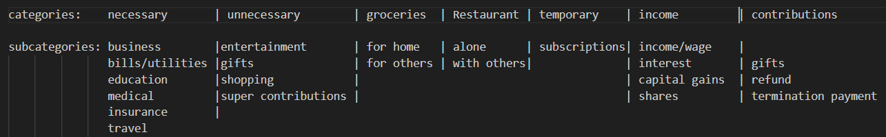

# My Accounting
#### Video Demo: https://youtu.be/QWgeDFE7agQ 
#### Description:

components: 
* NavBar_maininterface: The main window that the user will interact with to access the other windows
* add_entry window: Responsible for adding entries to the database
* budgetor: Responsible for calculating the budget for the current month and calculating the recommended spending for each day
* report_page: shows the overview of the users expenses, revenue and net profit/loss
* statistics_page: shows illistrations of the the data through recommended graphs
* view_entrys: allows the user to view each entry in the data set with the use of search bars and filters
* Icon_operator: reponsible for fetching the images from the icons folder and returning the requested images to the program
* Spreadsheet_operator: reponsible for fetching the data from the CSV_files folder and returning the data to the program, as well as performing some calculations
* README.md

## Catagories and Subcatagories:
### expenses:
 #### Necessary: 
Expenses related to non-consumable assets or services deemed required for the preservation of the person and assets used for necessary day to day activities.
 #### Unnecessary: 
Expenses related to non-consumable assets or services not deemed required for the preservation of the person.
 #### Groceries: 
Expenses related to consumables deemed required for the preservation of the person or others.
 #### Restaurant: 
Expenses related to consumables not deemed required for the preservation of a person or could have been alternatively sourced.
 #### Temporary: 
Foreseen unnecessary expenses or repeated payments that are not required for the preservation of a person.

### revenues:
#### income: 
Revenue that is taxable by the relevant government
#### contributions: 
Revenue that is non-taxable by the relevant government

### Catagory/Subcatagory table:

note: the subcatagories are used as a decriptor for the user and can be used for any catagory, this table is only a recommendation.

## csv headers for sheets:
code | entity | amount | category | sub-category | description | date

## search bar
entity/description |category |sub-category | date range.
 

## devlog:
This is just a summary of expirences and design choices I've been having during the process of making this project.

#the original goal of this project was to make a cloud based user interface where the data would be secured on the cloud, however 
due to git hubs security rejecting JSON files on a public repository, I've had to move the scope to a localised data set to enure I
can submit this program in the first place. fortunitly its not to difficult to change the databases but it does mean having to change
repositorys. tho debating whether or not I should bring all the test files too. (I'll just explain it in the video)

#initially I was going to use SQLite to manage the data sets, but pandas feels like a good transition and less hassel on my end.

#its great how the system knows what rows are being selected makes the process of creating/deleting rows all the more easier.

#I ran into a bug in the program booting up all the scripts a once in the main menu, appearntly whatever window or Qwidget is opened
with the GUI first pops ups first before disappearing then having the program run normally, so instead of trying to get rid of a bug,
I made it a feature and put a "loading" page to appear first.

the navbar examples for this GUI package aren't that great, but the tool bar is cool and the best part is that the user can move
it to whatever side of the window they like, so I'll just make that the navbar

#I was considering making a tax system into the program, it would calculate the users total taxable income based on if the rows taxable 
was set to true and then filter the total by whatever tax bracket would fall into based on the algorithim I make. however the tax system
between Australia and America are different, not to mention I have no clue on how their taxes work so this will be an indepentant project

#for the catagories I think these are approppriate by an individual level, for the subcategories I gathered them from the banking
app I use the most since its a good range of catagories on their own.

#my partner made a valid point when she was going through my program and mentioned that the entries were inconsistant in the database
which my perspective is from human error (and me not paying attention), so I implemented a search bar with a drop down of the already 
existing entities to reduce this issue, fortunitly there is a completer function in the documentation of the GUI library so it was easy
enough to implement, also made sure to use a set and not a list so there are no repeated entities in the completer.

#I decided to organise my files so its a bit easier to sort through, however it can to the cost of having to write another script to adjust to the changes but at least it looks neater now. this now becomes the point where I have to stop since now I'm organising my folders and creating more work for my self.
